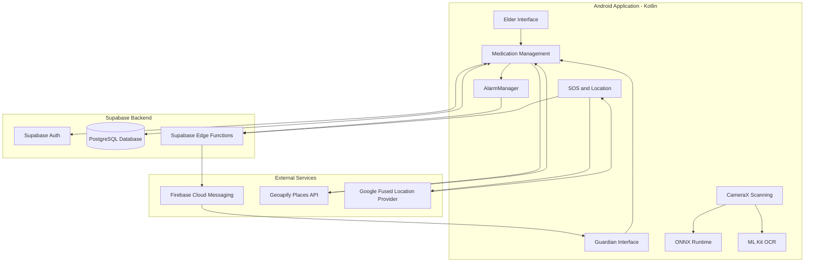
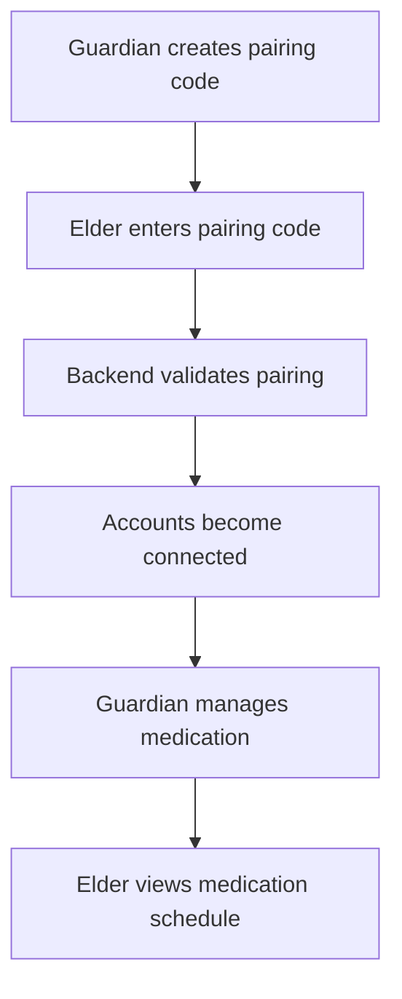
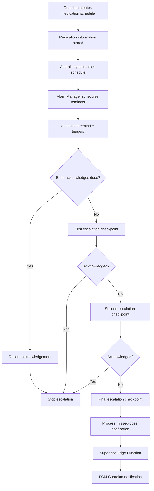
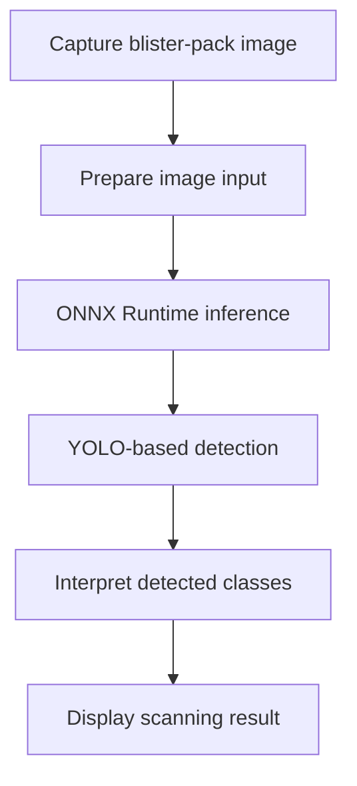
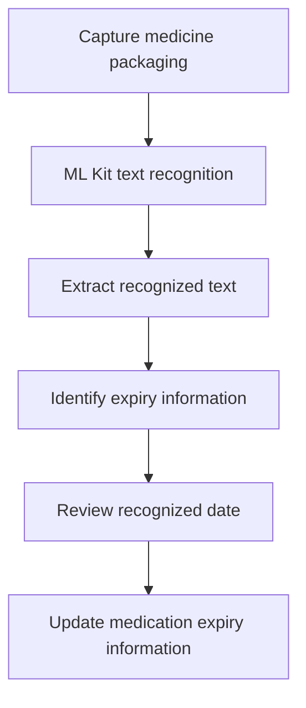
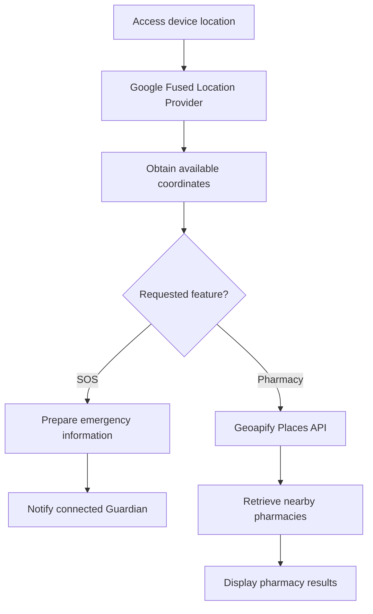

# SmartCare — Medication Adherence and Emergency Response System

**An Android-based healthcare assistance application designed to support elderly individuals with medication management while helping family caregivers stay informed and respond to important events.**

SmartCare combines medication scheduling, automated reminders, missed-dose escalation, caregiver notifications, emergency SOS, location sharing, nearby pharmacy discovery, AI-assisted blister-pack detection, and expiry-date recognition in a single mobile application.

---

## 1. Overview

Managing medication regularly can become challenging for elderly individuals, particularly when they have multiple prescriptions, different dosage schedules, or limited assistance throughout the day.

Family members and caregivers may also find it difficult to monitor whether medications have been acknowledged, identify missed doses promptly, or respond when an elderly family member needs help.

**SmartCare was developed to address these challenges through a connected medication management and emergency response system.**

The application provides two primary user roles:

- **Elder:** Manages daily medication routines, receives reminders, confirms doses, accesses medicine scanning features, finds nearby pharmacies, and can send emergency SOS alerts.
- **Guardian:** Connects with an elderly family member, manages medication schedules, monitors adherence information, receives missed-dose and other relevant notifications, and can respond to emergencies.

The system combines Android application functionality with a Supabase backend, cloud-based notification services, device-level scheduling, location services, and AI-related integrations.

### Project objectives

- Simplify daily medication management for elderly individuals.
- Reduce the chances of forgotten or unacknowledged medication doses.
- Keep guardians informed through a structured missed-dose escalation mechanism.
- Provide emergency communication with location information.
- Help users identify nearby pharmacies.
- Assist medication verification through blister-pack image analysis.
- Recognize medicine expiry dates using OCR.
- Provide a centralized platform for elderly users and their caregivers.

---

## 2. Key Features

### 2.1 Elder and Guardian Account Management

SmartCare supports two different user roles with separate application experiences.

**Elder features:**
- View assigned medications.
- Receive scheduled medication reminders.
- Confirm medication doses using the Taken action.
- View medication-related information.
- Access blister-pack scanning and expiry recognition.
- Send SOS alerts.
- Find nearby pharmacies.

**Guardian features:**
- Connect with an Elder using a pairing mechanism.
- Manage medication prescriptions and schedules.
- Monitor medication adherence.
- Receive missed-dose notifications.
- View adherence reports.
- Receive relevant medication-related alerts.
- Access emergency-related information.

### 2.2 Elder–Guardian Pairing

SmartCare provides a pairing mechanism that connects an Elder account with a Guardian account.

The Guardian generates a pairing code, which the Elder uses to establish the connection.

After pairing:
- The Guardian can manage medication information.
- The Elder can view the assigned medication schedule.
- Medication adherence information can be associated with the connected accounts.
- Guardian-related notification workflows can use the established relationship.

This creates a connected caregiving environment rather than treating medication management as an isolated activity.

### 2.3 Medication Management

Medication management is one of the application's central functionalities.

Guardians can create and manage medication schedules for connected elderly users.

Medication information includes details such as:
- Medication name.
- Dosage information.
- Scheduled time.
- Frequency or recurrence.
- Start and end dates, where applicable.
- Relevant medication details.

The Elder can view the assigned medications and their schedules.

The application uses the backend to maintain medication information and synchronize relevant data between the connected users.

### 2.4 Automated Medication Reminders

SmartCare uses Android's **AlarmManager** to schedule medication reminders on the device.

The reminder workflow is designed to notify the Elder when a medication dose is due.

**Workflow:**

1. A Guardian creates a medication schedule.
2. Medication information is stored through the backend.
3. The Android application synchronizes the relevant medication schedule.
4. AlarmManager schedules the corresponding reminder.
5. When the scheduled time arrives, the application triggers the reminder.
6. The Elder receives the medication notification.
7. The Elder can acknowledge the dose using the Taken action.

This approach uses Android's device-level scheduling capabilities instead of depending exclusively on continuous application execution.

### 2.5 Three-Stage Missed-Dose Escalation System

One of SmartCare's important features is its automated missed-dose escalation mechanism.

A reminder alone may not be sufficient when an Elder does not acknowledge a medication dose. SmartCare therefore includes a progressive escalation workflow intended to inform the Guardian when a dose remains unacknowledged.

**Escalation sequence:**

| Stage | Event | System behaviour |
|---|---|---|
| Initial reminder | Scheduled medication time (T+0) | Elder receives the medication reminder. |
| Escalation 1 | T+5 minutes | First missed-dose escalation checkpoint. |
| Escalation 2 | T+10 minutes | Second escalation checkpoint. |
| Escalation 3 | T+15 minutes | Final escalation checkpoint. |

The production-intended schedule uses the above intervals. During development and testing, the escalation interval was shortened to two minutes using a configurable `STEP_MINUTES` value to make testing faster.

**How the workflow operates:**

1. The medication reminder is triggered.
2. The application waits for the Elder's acknowledgement.
3. If the dose is acknowledged, the escalation process should be stopped.
4. If no acknowledgement is received, the next escalation checkpoint is processed.
5. The missed-dose workflow communicates with the backend.
6. Supabase Edge Functions handle the relevant missed-dose notification workflow.
7. Firebase Cloud Messaging (FCM) is used to deliver notifications to the Guardian.
8. The Guardian receives information about the missed-dose event.

The system is designed to avoid repeatedly processing the same escalation event through its dose-processing and acknowledgement mechanisms.

**Important distinction:** The Taken action represents a user's acknowledgement in the application. It does not independently prove that the medicine was physically consumed.

### 2.6 Guardian Notifications

SmartCare integrates **Firebase Cloud Messaging (FCM)** with Supabase Edge Functions for cloud-based notifications.

The notification architecture supports communication between the Elder's medication-related events and the Guardian.

The system includes:
- Missed-dose notifications.
- Guardian alerts related to medication events.
- Notification handling through backend functions.
- Separate in-app notification presentation.

Some notification types, including MISSED_DOSE and LOW_STOCK, are also presented as notification cards in the Guardian dashboard.

This combination of backend processing and push notifications helps keep guardians informed without requiring them to continuously monitor the application.

### 2.7 Medication Adherence Tracking and Reports

SmartCare maintains medication-related adherence information to help guardians understand the Elder's medication routine.

The adherence workflow records relevant dose acknowledgements and associates them with medication schedules.

The application includes an Adherence Report feature that presents medication-related adherence information.

The reporting functionality is intended to help guardians:
- Review medication adherence.
- Understand dose acknowledgement history.
- Identify missed or unacknowledged doses.
- Monitor medication-related patterns.

The report functionality uses the application's backend data rather than relying only on temporary device state.

### 2.8 AI-Based Blister-Pack Detection

SmartCare incorporates an AI-assisted blister-pack detection feature to help identify the condition of medicine blister packs.

The detection functionality uses a YOLO-based object detection model exported to **ONNX format** and integrated with the Android application through ONNX Runtime.

The model identifies three classes:

| Detection class | Meaning |
|---|---|
| `broken_tablet` | A broken or damaged tablet condition. |
| `empty_pocket` | An empty blister-pack pocket. |
| `filled_tablet` | A blister-pack pocket containing a tablet. |

**Detection workflow:**

1. The user accesses the medicine scanning feature.
2. The application captures or obtains a blister-pack image.
3. The image is prepared for model inference.
4. The ONNX model processes the image.
5. The model produces detection results.
6. The application interprets the detected classes.
7. The resulting information is presented to support the medicine verification workflow.

**Model information:**
- Model format: ONNX.
- Model input: `images`.
- Input shape: `1 × 3 × 640 × 640`.
- Input format: RGB image tensor.
- Output shape: `1 × 7 × 8400`.
- Inference runtime: ONNX Runtime.

The model is intended to assist users in inspecting blister packs. Its output should be treated as an AI-assisted indication rather than a medically validated confirmation that a dose has been consumed.

### 2.9 Expiry-Date Recognition Using OCR

SmartCare also incorporates expiry-date recognition to help users identify the expiry information printed on medication packaging.

The application uses **Google ML Kit Text Recognition** to extract text from captured medicine images.

**Workflow:**

1. The user accesses the expiry scanning feature.
2. An image of the medicine packaging is captured.
3. ML Kit processes the image and recognizes visible text.
4. The application extracts the relevant expiry-date information.
5. The recognized date is presented for review.
6. The user can use the scanner workflow to update the medication's expiry information.

The application uses text recognition to assist with expiry-date identification. OCR results can depend on image quality, lighting, printing quality, and the format of the printed date.

Recognized expiry information should therefore be checked against the original medicine packaging before it is relied upon.

### 2.10 SOS Emergency Alert and Location Sharing

SmartCare includes an SOS feature designed to help an Elder communicate an emergency to the connected Guardian.

The application uses Android location capabilities, including Google Fused Location Provider, to obtain location information.

**Emergency workflow:**

1. The Elder activates the SOS feature.
2. The application accesses the available device location.
3. The emergency workflow prepares the relevant location information.
4. The application communicates the emergency information through the implemented backend and notification flow.
5. The Guardian can receive emergency-related information and location details.

The purpose of this feature is to make it easier for guardians to understand where the Elder may need assistance.

Location availability depends on device permissions, GPS settings, network connectivity, and the availability of a location fix.

### 2.11 Nearby Pharmacy Discovery

SmartCare integrates the **Geoapify Places API** to help users discover pharmacies near their current location.

**Workflow:**

1. The application obtains the user's available location.
2. The application makes a request to the Geoapify API.
3. The API returns nearby pharmacy information.
4. The application processes the response.
5. Pharmacy information is displayed to the user.

The integration supports nearby pharmacy discovery based on location.

During development, the integration was tested successfully and returned pharmacy results, including a response containing 20 pharmacy entries.

The results depend on location accuracy, API availability, network connectivity, and the coverage of the location data provider.

---

## 3. Technology Stack

SmartCare combines Android development, backend services, database integration, notification infrastructure, AI inference, and external APIs.

| Category | Technology | Purpose |
|---|---|---|
| Programming language | Kotlin | Android application development |
| Android UI | Jetpack Compose | Application user interface |
| IDE | Android Studio | Android development and debugging |
| Backend platform | Supabase | Backend services and application integration |
| Database | PostgreSQL | Persistent application data |
| Backend functions | Supabase Edge Functions | Server-side event and notification processing |
| Authentication | Supabase Auth | User authentication |
| Push notifications | Firebase Cloud Messaging | Guardian and application notifications |
| Local scheduling | Android AlarmManager | Medication reminders and escalation scheduling |
| Background processing | WorkManager | Background task support |
| Camera | CameraX | Image capture for scanning workflows |
| AI model format | ONNX | Blister-pack detection model |
| AI inference | ONNX Runtime | On-device model inference |
| Object detection | YOLO-based model | Blister-pack condition detection |
| OCR | Google ML Kit Text Recognition | Expiry-date text recognition |
| Location | Google Fused Location Provider | Device location retrieval |
| Places API | Geoapify | Nearby pharmacy discovery |
| API testing | Postman | API request and response testing |
| Version control | Git and GitHub | Source code management |

---

## 4. System Architecture

SmartCare follows a mobile-client and cloud-backend architecture.

The Android application handles user interaction, local medication reminders, scanning workflows, location access, and application-level processing.

Supabase provides backend services and persistent data storage, while Firebase Cloud Messaging supports push notification delivery.

External services provide additional functionality such as pharmacy discovery and location-based services.

### High-level architecture



The diagram represents the major application components and their integrations. Individual feature flows may use additional internal services and application components.

---

## 5. Important Application Workflows

### Workflow A: Elder–Guardian Connection



### Workflow B: Medication Reminder and Escalation



The escalation interval is configurable. The production-intended checkpoints are 5, 10, and 15 minutes after the initial reminder.

### Workflow C: Blister-Pack Detection



### Workflow D: Expiry-Date Recognition



### Workflow E: SOS and Pharmacy Discovery



---

## 6. Backend and Data Integration

SmartCare uses Supabase as its backend platform.

The application communicates with backend services to support authentication, Elder–Guardian relationships, medication management, adherence information, and notification workflows.

The backend architecture includes:

- Supabase Authentication for user authentication.
- PostgreSQL for persistent application data.
- Supabase Edge Functions for server-side processing.
- Firebase Cloud Messaging for push notifications.

The Android application integrates these services to synchronize relevant information and coordinate workflows across the Elder and Guardian experiences.

The backend database is part of the shared team implementation. Database creation and initial setup were handled as a separate area of team development, while application-side integration connects the Android features with the backend services.

---

## 7. Testing and Validation

Testing was performed during implementation to verify individual features and their integration.

Areas covered include:

- Medication scheduling and reminder workflows.
- Missed-dose escalation behaviour.
- Guardian notification integration.
- Supabase backend communication.
- API request and response validation using Postman.
- Pharmacy API integration and response handling.
- Blister-pack model validation in ONNX format.
- OCR-based expiry recognition workflow.
- Integration of application features across the Elder and Guardian experiences.

The ONNX model was also checked for model compatibility, including its input and output specifications.

The project was developed and tested as an academic prototype. This does not represent formal clinical validation, large-scale production testing, or a guarantee of notification delivery under every Android device condition.

---

## 8. Project Setup

The following information describes the general development setup. Backend configuration and project-specific Gradle settings must match the actual repository version.

### Prerequisites

- Android Studio.
- Android SDK compatible with the project's Gradle configuration.
- A compatible JDK.
- Git.
- An Android emulator or physical Android device.
- Access to the configured Supabase project.
- Firebase project configuration for notification functionality.
- Geoapify API key for pharmacy discovery.

### Clone the repository

```bash
git clone <YOUR_SMARTCARE_GITHUB_REPOSITORY_URL>
```

Open the cloned project in Android Studio and allow Gradle synchronization to complete.

### Configure backend services

The application requires the relevant backend configuration to connect to the Supabase project.

Configure the required project URL, API credentials, and any project-specific configuration expected by the Android source code.

Ensure that the required backend resources are available, including the database structures, authentication configuration, and Edge Functions used by the application.

### Configure Firebase

Set up the Firebase project and configure Firebase Cloud Messaging.

Add the appropriate Android Firebase configuration file to the location expected by the project.

Ensure that the required notification permissions and device settings are configured for testing.

### Configure external APIs

Configure the Geoapify API key and any other external-service credentials required by the project.

Do not commit private API keys, service-role credentials, Firebase private keys, or other sensitive configuration files to a public repository.

### Run the application

1. Open the project in Android Studio.
2. Synchronize the Gradle project.
3. Configure the required backend and external-service credentials.
4. Connect an Android emulator or physical device.
5. Build and run the application.
6. Test the Elder and Guardian workflows using the required account and backend configuration.

**Note:** Exact configuration filenames, Gradle commands, database setup scripts, and backend deployment instructions should be documented against the current repository rather than assumed.

---

## 9. Security and Privacy Considerations

SmartCare handles information related to medication schedules, user accounts, caregiver relationships, and location.

The following considerations are important:

- Authentication should be required for protected application functionality.
- Elder and Guardian permissions should be enforced according to their roles.
- Backend access should be protected using appropriate authorization and database policies.
- Sensitive credentials must not be stored in publicly accessible source files.
- Location information should only be accessed with the necessary device permissions.
- Notification payloads should avoid unnecessarily exposing sensitive medical information.
- AI and OCR outputs should not be treated as definitive medical decisions.

A production deployment would require additional security review, privacy assessment, access-control verification, and reliability testing.

---

## 10. Current Implementation Status

SmartCare has been developed as a functional academic project prototype.

The following table summarizes the major implemented areas:

| Module | Implementation |
|---|---|
| Elder and Guardian accounts | Implemented |
| Elder–Guardian pairing | Implemented |
| Medication management | Implemented |
| Android medication reminders | Implemented |
| Missed-dose escalation | Implemented; timing configurable |
| Guardian notification integration | Implemented |
| Medication adherence tracking | Implemented |
| Adherence reporting | Implemented |
| AI blister-pack detection | Integrated |
| Expiry-date OCR | Integrated |
| SOS and location functionality | Implemented |
| Nearby pharmacy discovery | Integrated and API-tested |
| Backend and database integration | Implemented |

Feature availability and reliability can depend on backend configuration, device permissions, network connectivity, notification settings, and external-service availability.

---

## 11. Known Limitations and Future Improvements

SmartCare is an academic prototype and has not been clinically validated or certified as a medical device.

Some important areas require further testing and improvement before a production deployment.

### Reliability improvements
- Test reminder restoration after device restart.
- Improve handling of battery restrictions and Android background execution limits.
- Validate escalation behaviour under network interruptions.
- Improve retry and recovery handling for notification delivery.
- Verify duplicate-event prevention and acknowledgement handling.

### AI improvements
- Improve blister-pack detection accuracy across different medicine packaging types.
- Evaluate model performance under different lighting conditions and camera angles.
- Reduce false detections and misclassification.
- Improve expiry-date extraction for different printing styles and date formats.
- Add stronger user confirmation for uncertain AI and OCR results.

### Caregiver experience
- Improve notification acknowledgement and dismissal workflows.
- Expand adherence reporting and historical insights.
- Improve communication between connected Elder and Guardian accounts.
- Enhance emergency communication and recovery workflows.

### Security and production readiness
- Perform comprehensive authorization and database-policy testing.
- Review sensitive information handling.
- Test across different Android devices and OS versions.
- Perform broader integration and usability testing.

---

## 12. Project Information

| Detail | Description |
|---|---|
| Project name | SmartCare |
| Full title | SmartCare — Medication Adherence and Emergency Response System |
| Project type | Academic Major Project |
| Platform | Android |
| Development language | Kotlin |
| UI framework | Jetpack Compose |
| Backend | Supabase |
| Database | PostgreSQL |
| AI integration | ONNX Runtime and ML Kit OCR |
| Notifications | Firebase Cloud Messaging |
| External API | Geoapify |
| Location services | Google Fused Location Provider |

---

## 13. Acknowledgement

SmartCare was developed as a collaborative academic project.

The application brings together Android development, backend integration, database management, AI-based image processing, notification systems, and external API integrations.

The project represents a team effort to explore how software engineering can be applied to a meaningful real-world problem: supporting elderly individuals and helping their families coordinate care.

---

## 14. Disclaimer

SmartCare is an academic software prototype developed for educational and demonstration purposes.

It is not a substitute for professional medical advice, medical supervision, or emergency services.

Medication acknowledgement in the application does not confirm actual medicine consumption. AI blister-pack detection and OCR-based expiry recognition may produce inaccurate results and must be independently verified.

Users should not rely solely on this application for medication safety or emergency response.
